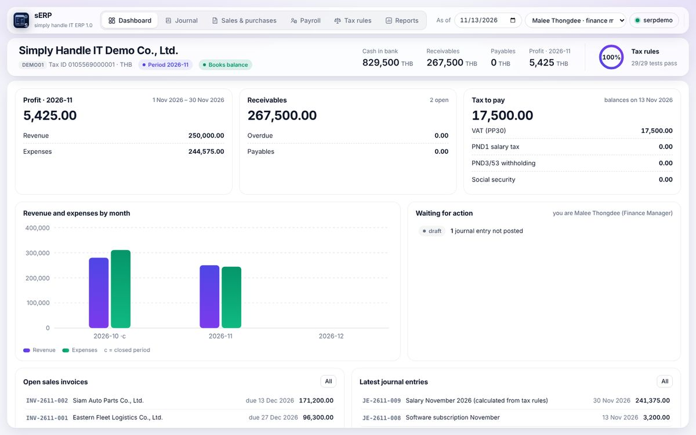

# sERP — simply handle IT ERP · version 1.0

Accounting, invoices, payroll and **user-revisable tax rules** on your own PostgreSQL database.
Same look and themes as [sUML](https://github.com/warisr040/sUML) and [sTrack](https://github.com/warisr040/sGantt).

**[⬇ Download sERP](https://github.com/warisr040/sERP/archive/refs/heads/main.zip)** (always the latest; unzip, open `sERP-main`, double-click `sERP.bat`) · **[Quick guide](https://github.com/warisr040/sERP/raw/main/sERP-Quick-Guide.html)** — one HTML file with screenshots: download and double-click to open (also inside the app: Help → Open the quick guide)

## Start

| | How |
|---|---|
| **Windows** | Install PostgreSQL 16+, then double-click `sERP.bat`. The first start finds Python (or installs Python 3.12 for your user with winget — no PATH setting needed), creates a private environment, and opens the app in its own window (Edge app mode). |
| **macOS / Linux** | `./sERP.sh` |
| **Docker** (PostgreSQL included) | `docker compose up -d`, then open http://127.0.0.1:47394. The first start loads the sample company. Change the password in `docker-compose.yml` first. |

On the first start, sERP asks for the PostgreSQL connection. If the database is empty, **Create sample database** builds it with a sample company, the Thai tax rules and two months of data. Settings are saved to `serp.config.json` (excluded from git).

The server listens on 127.0.0.1 only. Nothing goes to the internet.

## What's inside

| View | What you can do |
|---|---|
| Dashboard | Profit for the period, receivables and overdue amounts, tax to pay, revenue and expenses by month, items waiting for action |
| Journal | Browse, filter and search entries; create entries (they must balance before posting); post drafts; reverse posted entries |
| Sales & purchases | Sales invoices and purchase bills. **VAT comes from the approved VAT rule** in force on the document date. Record payments with **withholding tax from the approved rule** (by income type, with the 1,000 baht minimum) |
| Payroll | Draft a run, enter overtime, commission, allowances and deductions, recalculate, then post. **Social security and salary tax come from the rules** and each employee's approved tax profile. Payslips show how the tax was calculated |
| Tax rules | Rules and versions, with the ones in force highlighted; test cases; export JSON/Excel; import with a check and a list of changes; submit/approve/reject (maker-checker); back-dating reports; policies; change log |
| Reports | Trial balance, profit & loss, balance sheet, tax summary (VAT, PND1, PND3/53, social security). CSV export and print |

Five themes: Basic, Dark, Starry Night, Forest, Burning. Shortcuts: <kbd>Alt</kbd>+<kbd>1</kbd>…<kbd>6</kbd> switch views, <kbd>Alt</kbd>+<kbd>N</kbd> creates a new item, <kbd>F1</kbd> opens help. They use key positions, so they work on Thai, English, Chinese and Japanese keyboard layouts.

## Folders

| Folder | What |
|---|---|
| `serp_server.py` | Application server and JSON API (Python standard library + psycopg) |
| `web/` | The app: `index.html` (single file, no external dependencies) + logo |
| `engine/` | Tax rule engine (`taxrules.py`), database tool (`taxdb.py`), SQL (`01_core.sql`, `02_tax_rules.sql`), the sample dump `erp_sample_v2.sql`, the rule file definition, and `build_sample.py` / `verify.py` |
| `sERP-Quick-Guide.html` | Step-by-step guide in one file (Forest theme by default) |
| `docs/` | Tax rule requirements and design decisions |
| `tests/test_api.py` | 22 API checks: VAT, withholding, closed periods, balancing, roles, import checks, request protection |
| `logo/` | SVG, PNG 16–512 px and `serp.ico` |

## Important limits in 1.0
- **No sign-in yet.** The toolbar's *acting as* list chooses the user, and the database enforces maker-checker against that name. Only run sERP on a trusted computer until sign-in is added.
- Back-dating reports are produced and confirmed, but the adjustment entries are not posted automatically yet.
- Thai tax values marked "verify before go-live" in the rules should be checked by an accountant.
